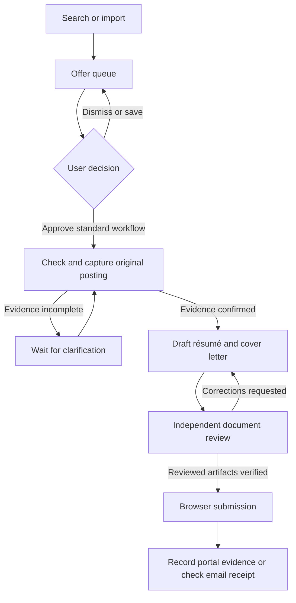

# Internship Pipeline

**Human-in-the-loop LLM orchestration for internship applications.** A Python service coordinates the search, review and application workflow through a mobile web app and Telegram. This repository presents the architecture and an interactive walkthrough of a complete application dossier.

[Try the interactive demo](https://alecbossard.github.io/internship-pipeline/demo/) · [Browse the demo source](demo/)

## Walk through a sample application

The demo follows one fictional dossier through three views adapted from the live app. All evidence and worker results are scripted. Use the walkthrough controls to advance through the stages at your own pace.

1. **Offers.** Inspect the sample posting, swipe to open approval and confirm the exact offer.
2. **Applications.** Verify the captured posting, preview the draft résumé and letter, and follow an independent review that sends one unsupported claim back for correction.
3. **Submission.** Answer the employer's availability question, resume the sample submission and open the matching email receipt.
4. **Activity.** Inspect the worker statuses and the log of decisions and results.

To run it locally, download the repository and open `demo/index.html`.

## How the live workflow works

The user starts a search or imports an offer. The service applies eligibility criteria, deduplicates results and records source links. The user reviews an offer and explicitly approves it before application work can start.

The app also offers a document-only path for users who prefer to submit manually. This path ends with reviewed PDFs ready to download.

## Engineering decisions

| Decision | How it works |
| --- | --- |
| Approval tied to the offer shown | The service checks the offer ID and revision before accepting the user's decision. |
| Separate tools by role | An isolated public browser captures the posting. Other workers handle writing, review, submission and receipt verification. |
| Evidence linked to reviewed documents | The captured posting and document hashes are associated with the dossier. The service checks the reviewed files before submission. |
| Recoverable work | A single service writes durable queue and dossier state. If the result of a submission attempt is uncertain, the dossier waits for verification before another attempt. |

**Stack** · Python, Codex CLI, Playwright MCP, JavaScript, Telegram, Google Docs, Linux and systemd.

## My contribution

I defined the requirements, designed the approval workflow and refined the interface and edge cases through real use. I directed implementation and Linux deployment with substantial assistance from coding agents.

## Repository scope

The source here implements the browser walkthrough. The case study describes the deployed personal application. The live service and candidate records are private.
